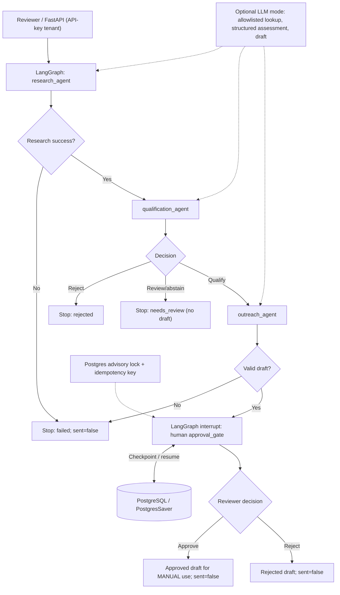

# AgentQual — Stateful Lead Qualification and Human Approval

> **Independent engineering demonstration, not client-delivered software or a live production service.** Built to demonstrate engineering choices, reproducible experiments, and tested failure behavior, not to imply prior commercial ownership.

## The engineering problem

B2B lead qualification contains useful deterministic steps alongside optional language-model judgments. A workflow needs a defensible audit trail: which company facts were used, why the lead qualified, what draft was produced, and who approved it. Tool failures, repeated approvals and untrusted model output should not silently send messages.

**Goal:** Construct a bounded, inspectable service with explicit transitions and resumable human review. **Non-goals:** autonomous sales outreach, a commercial CRM integration, external enrichment of real companies, real-world marketing performance.

## Architecture (current implementation)

**Core stack:** Python, FastAPI, LangGraph, Pydantic, PostgreSQL checkpoint storage, Docker Compose, GitHub Actions, Playwright/Chromium. Research defaults to a synthetic JSON-backed lookup. OpenAI/Gemini draft generation and OpenAI model-assisted research/qualification require separately configured API access and are *disabled by default*. The three named 'agents' are graph responsibilities, not autonomous independent agent services.

### Why these design choices?

- **LangGraph over an ad hoc chain:** explicit conditional routing and a native interrupt/resume mechanism. Tradeoff: more framework complexity than a deterministic, single-pass workflow would need.
- **Deterministic ICP gate:** industry, region and employee range remain server-checked, including a veto over unsupported model-positive outcomes. Tradeoff: rigid matching may exclude semantically relevant cases.
- **Human-controlled approval:** approval is *not sending*. There is deliberately no outbound messaging implementation.
- **PostgreSQL checkpoints:** approval can be resumed after the API process restarts. Per-thread advisory locks serialize concurrent approval requests; the request UUID enables safe replay of the same decision after commit. This is not a general transactional-outbox implementation.
- **Allowlisted model tools:** model-directed lookup can call exactly one defined tool with the expected company ID; arbitrary URLs, external writes and multi-call plans fail closed.

## Reproducible evidence (verified on GitHub)

| Verification | What it actually proves | Evidence |
|---|---|---|
| 82 passing automated tests | Code paths including routing, mocked model failures, security checks and persistence integration | [Python CI](https://github.com/sumedha271297-hash/agentqual-multi-agent-intelligence/actions/runs/45243287837) |
| Docker Compose staging rehearsal | Actual HTTP probes of production-mode API + PostgreSQL on an ephemeral runner; cross-tenant denial, approval replay and conflict | [Staging workflow](https://github.com/sumedha271297-hash/agentqual-multi-agent-intelligence/actions/runs/45243288064) |
| Restart recovery | A pending approval survived an actual API container restart, with PostgreSQL retained | [Staging workflow](https://github.com/sumedha271297-hash/agentqual-multi-agent-intelligence/actions/runs/45243288064) |
| Real browser walkthrough | Chromium interacted with actual FastAPI + LangGraph endpoints; video and screenshots uploaded as CI artifact | [Browser artifact](https://github.com/sumedha271297-hash/agentqual-multi-agent-intelligence/actions/runs/45243288064) |
| 40-case v2 rubric | Deterministic scoring against explicitly authored **fictional** labels; 87.5% F1 *on that toy matrix* | [Evaluation script](../scripts/evaluate_v2.py) |
| Six blocked policy probes | Mocked adversarial inputs rejected by application checks, not empirical model jailbreak resistance | [Security script](../scripts/security_matrix.py) |

The performance smoke test uses in-process HTTP clients and should **not** be characterized as cloud throughput, sustained performance, or an SLA.

## Observable walkthrough

1. Start the local development API with `uvicorn app.api:app --host 127.0.0.1 --port 8000` and open `http://127.0.0.1:8000/demo`.
2. Run fictional company `c01`: research and qualification lead to a draft and a paused approval interrupt.
3. Inspect checkpoint; approve with an idempotency key; verify `approved=true` but `sent=false`.
4. Run `c02`: qualifications reject it, without draft approval or a send action.
5. For real PostgreSQL rehearsal, use the private/local `deploy/staging.compose.yml` environment and `scripts/staging_probe.py`. Do not expose the development service on the internet.

## Limitations and next validation gates

1. **No verified live LLM outcome.** The OpenAI API secret and manual opt-in workflow exist, but billable provider evaluation has not succeeded. Factual grounding, token costs and real inference latency are unmeasured.
2. **Synthetic labels are not independent ground truth.** Company profiles overlap across development/holdout policies; future work needs permissioned samples and blinded reviewers.
3. **No public cloud deployment.** The successfully verified staging environment is ephemeral Docker Compose on a GitHub runner, not a managed internet-facing service.
4. **Access control is deliberately small.** Tenant API keys, no per-user roles, no rate limiting, no complete audit-trail retention or secrets lifecycle.
5. **No autonomous end-to-end sales agent.** Qualification uses a deterministic baseline; optional LLM judgments are bounded. No sending, CRM, real sales results or operational customer metrics.

## Recruiter-ready summary

> Built **AgentQual**, an independent FastAPI/LangGraph workflow demonstration featuring deterministic and optional model-assisted lead qualification, bounded tool calling, PostgreSQL-backed human approval, tenant-aware access controls and idempotent approval handling. Verified with 82 automated tests, real Docker Compose restart/recovery probes and a genuine Chromium user-flow recording. Evaluations use fictional data and do not establish real-provider performance or production operation.

**What should *not* be claimed:** client deployment; years of commercial multi-agent ownership; revenue uplift; real-world 87.5% predictive accuracy; cloud SLOs; live-model accuracy; fully autonomous agents.
