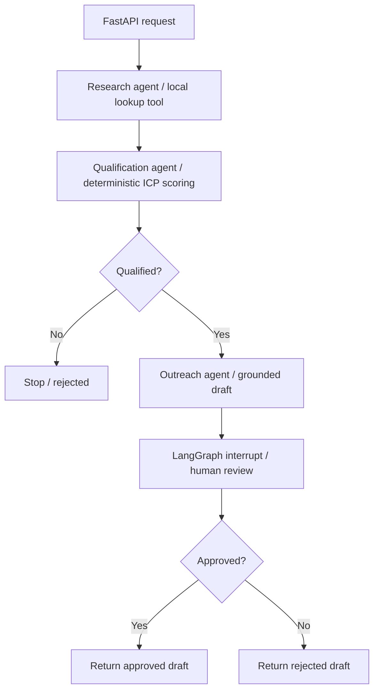

# Architecture

**State:** `AgentState` contains company ID, ICP, evidence, qualification, route, draft, approval, sent status. Graph transitions are explicit and auditable.

**Tool:** The research agent calls a local JSON-backed company lookup. No live external company research, autonomous tool planning, LLM inference, or email sending is implemented. Agents are named responsibility-specific graph nodes; they are not independently reasoning LLM agents.

**Approval:** LangGraph's `interrupt` pauses execution and `Command(resume=...)` resumes it using a thread ID and in-memory checkpointer. Memory is ephemeral; production needs durable storage, authentication, rate limits, observability, and secret management.

**Security:** No auto-send endpoint. Synthetic company data. Do not put personal data in the dataset. The HTTP demo is unauthenticated and must not be exposed publicly without access controls.
